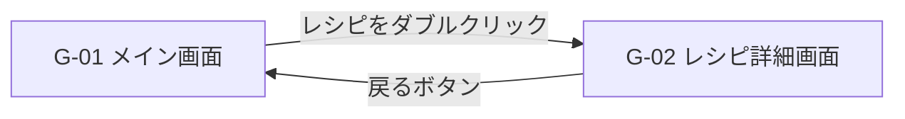
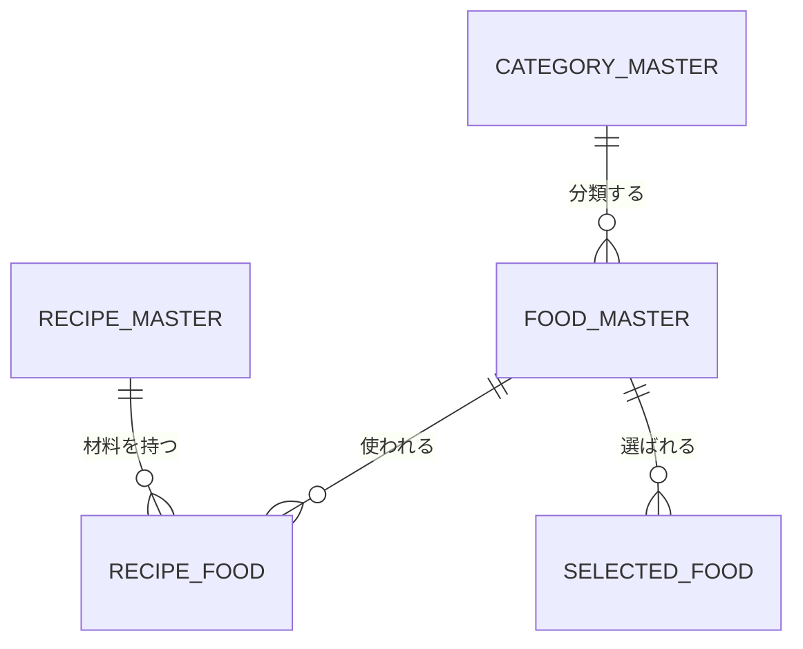
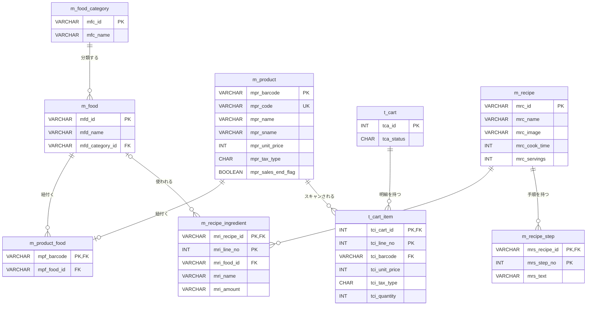
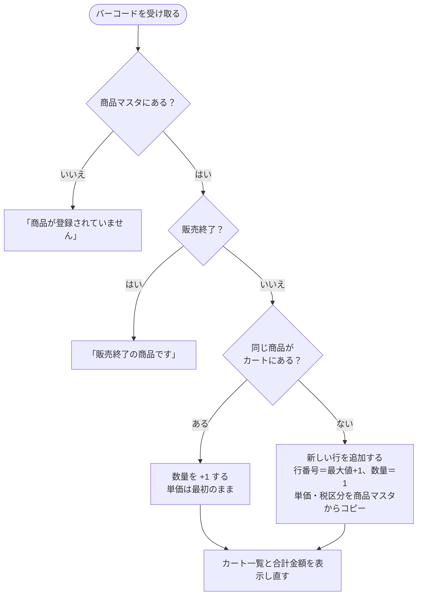

# レシピ検索システム 仕様書（応用編）

| 項目 | 内容 |
|---|---|
| システム名 | レシピ検索システム |
| 使用言語 | HTML / CSS / JavaScript。DB版はPHP + MySQL（13章） |
| 参照資料 | レシピ検索＿応用編設計書.xlsx（要求定義・要件定義・機能設計・画面レイアウト） |
| 版数 | 2.0 |
| 更新日付 | 2026/10/08 |

### 更新履歴
| 版数 | 更新日付 | 内容 |
|---|---|---|
| 1.0 | 2026/10/08 | 初版作成 |
| 1.1 | 2026/10/08 | 食材の追加方法を「ドロップダウンで選択＋追加ボタン」に確定（パソコン・スマートフォン共通）。チェックボックスによる検索対象選択を削除 |
| 1.2 | 2026/10/08 | 検索方法を変更：対象外食材は検索対象から除くのではなく、対象外食材を材料に含むレシピを一覧に表示しないようにした |
| 2.0 | 2026/10/14 | DB版（PHP + MySQL）として13章「DB設計」（ER図・テーブル定義・処理ルール・テスト用データ）を追加 |

---

## 1. システム概要

### 1.1 目的
スーパーで**買い物をしながら**、「カートに入れた商品」と「家にある食材」を組み合わせて作れるレシピを探せるようにする。

### 1.2 利用イメージ
1. 買い物中、カートに入れた商品を「カート内食材」に追加する
2. 家にある食材を「カート外食材（家にある食材）」に追加する
3. 使いたくない食材（アレルギー・苦手など）を「対象外食材」に追加する
4. 「レシピを探す」ボタンを押すと、対象外食材を使うレシピを除いて、使える食材が多く含まれるレシピから順に一覧表示される
5. レシピをダブルクリックすると、材料・作り方などの詳細が表示される

### 1.3 検索の考え方

```
検索対象食材 ＝ カート内食材 ∪ カート外食材
除外レシピ   ＝ 材料に対象外食材を1つでも含むレシピ
一致数       ＝ レシピの材料のうち、検索対象食材に含まれる食材の数
```

- **対象外食材を材料に含むレシピは、一致数に関係なく一覧に表示しない**
- 残ったレシピのうち、一致数が **1以上** のものを、一致数の **多い順** に表示する
- カート内とカート外の両方に同じ食材がある場合は **1つとして数える**

### 1.4 初学者向けの簡略化（設計書「非実装機能」より）
| 本来の機能 | 本システムでの扱い |
|---|---|
| バーコードスキャンで商品登録 | 実装しない。**食材マスタからドロップダウンで選択**する（仮想スキャン） |
| 商品→食材の紐付け（「キャベツ1玉」→「キャベツ」） | 実装しない。最初から食材名で登録する |
| 数量の管理 | 実装しない。食材の「ある／ない」だけで判定する |
| データベース | 使用しない。マスタは JavaScript の配列で持つ |
| 塩・砂糖・油などの基本調味料 | 家に常備している前提とし、食材マスタに登録せず照合対象外にする |
| チェックボックスで検索対象を選ぶ | **実装しない**。一覧に登録した食材はすべて検索対象とし、使いたくない食材は「対象外食材」に登録し、その食材を使うレシピを一覧から外す |

### 1.5 食材の追加方法（確定）
- パソコン・スマートフォンとも、**ドロップダウンで食材を選び「追加」ボタンを押して追加**する
- ドロップダウンのダブルクリックによる追加は行わない
- 一覧からの削除は、**一覧の食材をダブルクリック → 確認メッセージ → OK** で行う

---

## 2. 機能一覧

設計書「機能設計（１）」の必須機能を、本システムの範囲に合わせて整理したもの。

| No. | 機能区分 | 機能名 | 内容 | 必須 |
|---|---|---|---|---|
| F-01 | 食材管理 | カート内食材追加 | 食材マスタから選択し、カート内食材一覧に追加する | 必須 |
| F-02 | 食材管理 | カート内食材一覧表示 | カート内食材を一覧表示する | 必須 |
| F-03 | 食材管理 | カート内食材削除 | 一覧の食材をダブルクリック → 確認 → OKで削除 | 必須 |
| F-04 | 食材管理 | カート外食材追加 | 食材マスタから選択し、カート外食材一覧に追加する | 必須 |
| F-05 | 食材管理 | カート外食材一覧表示 | カート外食材（家にある食材）を一覧表示する | 必須 |
| F-06 | 食材管理 | カート外食材削除 | 一覧の食材をダブルクリック → 確認 → OKで削除 | 必須 |
| F-07 | 食材管理 | 対象外食材追加 | 食材マスタから選択し、対象外食材一覧に追加する | 必須 |
| F-08 | 食材管理 | 対象外食材一覧表示 | 対象外食材を一覧表示する | 必須 |
| F-09 | 食材管理 | 対象外食材削除 | 一覧の食材をダブルクリック → 確認 → OKで削除 | 必須 |
| F-10 | レシピ検索 | 検索条件チェック | 検索対象食材が0件なら検索せずメッセージ表示 | 必須 |
| F-11 | レシピ検索 | レシピ検索・食材一致判定 | 対象外食材を含むレシピを除き、残りのレシピについて検索対象食材と材料を照合し一致数を算出 | 必須 |
| F-12 | レシピ検索 | 並び替え | 一致数の多い順に並べる | 必須 |
| F-13 | レシピ検索 | 検索結果なし処理 | 一致するレシピがない場合メッセージ表示 | 必須 |
| F-14 | レシピ表示 | レシピ一覧表示 | No.・画像・レシピ名・一致状況（例「5食材中4食材」）を表示 | 必須 |
| F-15 | レシピ表示 | レシピ詳細表示 | 一覧をダブルクリックで詳細画面を表示 | 必須 |
| F-16 | レシピ表示 | 材料表示（保有／不足） | 材料ごとに「あり」「不足」を区別して表示 | 必須 |
| F-17 | レシピ表示 | 調理手順表示 | 作り方を番号順に表示 | 必須 |
| F-18 | 画面操作 | 画面遷移 | メイン画面 ⇔ 詳細画面（戻るボタン） | 必須 |
| F-19 | 拡張 | スマートフォン対応 | 画面幅に応じてレイアウトを縦並びにする | 必須 |
| F-20 | 拡張 | お気に入り／買い物リスト／栄養情報／AI提案 | 今回は実装しない（将来の拡張） | 任意 |

> 設計書の「レシピ検索対象設定（チェックボックス）」「チェックを外す」「検索対象状態管理」は今回の範囲から削除した（12章参照）。

---

## 3. 画面仕様

### 3.1 画面一覧
| 画面ID | 画面名 | 説明 |
|---|---|---|
| G-01 | メイン画面 | 食材の登録・削除と、レシピ検索・一覧表示を行う |
| G-02 | レシピ詳細画面 | 選択したレシピの詳細を表示する |

> **実装方針：** 1つの `index.html` の中に2つの画面（`<section>`）を作り、表示／非表示を切り替える。
> 別のHTMLファイルに移動すると登録した食材が消えてしまうため、初学者にはこの方法が簡単で安全。

### 3.2 画面遷移



### 3.3 G-01 メイン画面 レイアウト（設計書「画面レイアウト（１）」準拠）

```
┌──────────────────────────────────────────────────────────────┐
│ レシピ検索システム                                              │
├───────────────────────────┬──────────────────────────────────┤
│【カート内食材】              │【レシピ一覧】   [ レシピを探す ]    │
│ 食材：[ キャベツ      ▼] [追加] │ ┌───┬──────┬──────────┬────────┐ │
│ ┌───────────────────────┐ │ │No.│ 画像 │ レシピ名    │ 一致     │ │
│ │ キャベツ               │ │ ├───┼──────┼──────────┼────────┤ │
│ │ にんじん               │ │ │ 1 │ [img]│ 野菜炒め    │5食材中4 │ │
│ │ 豚バラ肉               │ │ │ 2 │ [img]│ 肉じゃが    │5食材中3 │ │
│ └───────────────────────┘ │ │ … │      │            │        │ │
│ ※ダブルクリックで削除        │ └───┴──────┴──────────┴────────┘ │
├─────────────┬─────────────┤ ※ダブルクリックで詳細表示            │
│【カート外食材】 │【対象外食材】  │                                  │
│ (家にある食材) │              │                                  │
│[玉ねぎ ▼][追加]│[ピーマン▼][追加]│                                  │
│┌───────────┐│┌───────────┐│                                  │
││ 玉ねぎ      │││ ピーマン    ││                                  │
││ 卵          ││└───────────┘│                                  │
│└───────────┘│              │                                  │
└─────────────┴─────────────┴──────────────────────────────────┘
```

スマートフォン幅（目安：768px未満）では、すべてのエリアを **縦1列** に並べる。

### 3.4 G-01 画面項目

| No. | エリア | 項目名 | 部品 | id（例） | 説明 |
|---|---|---|---|---|---|
| 1 | カート内食材 | 食材選択 | `<select>`（ドロップダウン） | `cartSelect` | 食材マスタの全食材をカテゴリごと（`<optgroup>`）に表示。先頭は「選択してください」 |
| 2 | カート内食材 | 追加ボタン | `<button>` | `cartAddBtn` | 選択中の食材を一覧に追加 |
| 3 | カート内食材 | 食材一覧 | `<ul>` | `cartList` | 追加した食材を表示。ダブルクリックで削除 |
| 4 | カート外食材 | 食材選択 | `<select>` | `homeSelect` | 同上 |
| 5 | カート外食材 | 追加ボタン | `<button>` | `homeAddBtn` | 同上 |
| 6 | カート外食材 | 食材一覧 | `<ul>` | `homeList` | 同上 |
| 7 | 対象外食材 | 食材選択 | `<select>` | `excludeSelect` | 同上 |
| 8 | 対象外食材 | 追加ボタン | `<button>` | `excludeAddBtn` | 同上 |
| 9 | 対象外食材 | 食材一覧 | `<ul>` | `excludeList` | 同上 |
| 10 | レシピ一覧 | レシピを探すボタン | `<button>` | `searchBtn` | レシピ検索を実行 |
| 11 | レシピ一覧 | レシピ一覧 | `<table>` | `recipeTable` | No.・画像・レシピ名・一致状況。行をダブルクリックで詳細へ |
| 12 | レシピ一覧 | メッセージ | `<p>` | `message` | 「食材を追加してください」等を表示 |

> 設計書の画面レイアウトにある各一覧の「チェック」列は設けない。食材一覧には食材名だけを表示する。

### 3.5 G-02 レシピ詳細画面 レイアウト

```
┌────────────────────────────────────────┐
│ [ ← 戻る ]                              │
│ 肉じゃが                                │
│ ┌──────────────┐  調理時間：30分          │
│ │   [画像]      │  一致：5食材中4食材      │
│ └──────────────┘                        │
│【材料（2人分）】                          │
│  ○ 牛こま肉   150g                      │
│  ○ じゃがいも  2個                       │
│  ○ にんじん   1/2本                      │
│  ○ 玉ねぎ    1個                        │
│  × 醤油      大さじ2   ← 不足（赤字）     │
│  （その他：砂糖・みりん・水）               │
│【作り方】                                │
│  1. じゃがいもは皮をむいて一口大に切る      │
│  2. ……                                  │
└────────────────────────────────────────┘
```

| No. | 項目名 | 説明 |
|---|---|---|
| 1 | 戻るボタン | メイン画面に戻る（登録した食材・検索結果はそのまま残す） |
| 2 | レシピ名 | レシピマスタのレシピ名 |
| 3 | レシピ画像 | レシピマスタの画像 |
| 4 | 調理時間 | 例「30分」 |
| 5 | 一致状況 | 例「5食材中4食材」 |
| 6 | 材料 | 材料名・分量。検索対象食材にあるものは「○」、ないものは「×（不足）」を赤字で表示 |
| 7 | その他の調味料 | 照合対象外の基本調味料（砂糖・塩など）を参考として表示 |
| 8 | 作り方 | 手順を番号順（`<ol>`）で表示 |

---

## 4. 操作仕様（イベント一覧）

| No. | 操作 | 対象 | 処理内容 |
|---|---|---|---|
| E-01 | ページを開く | 画面全体 | 食材マスタから3つの `<select>` の選択肢を作成する。一覧は空 |
| E-02 | ドロップダウンで食材を選び「追加」ボタンを押す（パソコン・スマートフォン共通） | 各「追加」ボタン | ① 未選択なら「食材を選択してください」と表示して終了<br>② 同じ一覧に既にあれば「〇〇は既に追加されています」と表示して終了<br>③ 一覧（配列）に追加し、画面を再表示<br>④ ドロップダウンを「選択してください」に戻す<br>⑤ レシピ一覧をクリアする（条件が変わったため） |
| E-03 | 一覧の食材をダブルクリック | 各食材一覧の項目 | ① `confirm("「〇〇」を一覧から削除しますか？")` を表示<br>② OK：配列から削除し再表示、レシピ一覧をクリア<br>③ キャンセル：何もしない |
| E-04 | レシピを探す | `searchBtn` | 5章の検索処理を実行し、レシピ一覧を表示 |
| E-05 | レシピ行をダブルクリック | レシピ一覧の行 | そのレシピの詳細画面（G-02）を表示 |
| E-06 | 戻る | 戻るボタン | メイン画面（G-01）を表示 |

### 4.1 同じ食材が複数の一覧にある場合
| ケース | 扱い |
|---|---|
| カート内とカート外の両方にある | 登録は可能。検索では1つとして数える |
| カート内（またはカート外）と対象外の両方にある | 登録は可能。**対象外が優先**され、その食材を使うレシピは表示しない |
| 同じ一覧に2回追加しようとした | 追加しない（メッセージ表示） |

---

## 5. 検索処理仕様

### 5.1 処理の流れ


### 5.2 並び順
1. **一致数** の多い順
2. 一致数が同じ場合は、**不足食材数**（材料数 − 一致数）の少ない順
3. それも同じ場合は、**レシピID** の小さい順

### 5.3 計算例
検索対象食材：キャベツ・にんじん・豚バラ肉・玉ねぎ・卵・じゃがいも
対象外食材：ピーマン

| レシピ | 材料（照合対象） | 一致数 | 表示 |
|---|---|---|---|
| 肉じゃが | 牛こま肉・じゃがいも・にんじん・玉ねぎ・醤油 | 3 | 5食材中3食材 |
| カレーライス | 豚こま肉・じゃがいも・にんじん・玉ねぎ・カレールー・米 | 3 | 6食材中3食材 |
| 親子丼 | 鶏もも肉・玉ねぎ・卵・米・醤油 | 2 | 5食材中2食材 |
| ~~野菜炒め~~ | 豚バラ肉・キャベツ・にんじん・**ピーマン**・もやし | （3） | **表示しない**（ピーマンを含むため） |
| ~~ナポリタン~~ | スパゲッティ・ウインナー・玉ねぎ・**ピーマン**・ケチャップ | （1） | **表示しない**（ピーマンを含むため） |

---

## 6. データ仕様（DBなし版）

> DB版のデータ設計は **13章** を参照。

DBは使わず、`js/data.js` に JavaScript の配列として定義する。
設計書の「DB設計_テーブル設計」シートには、以下の内容を記入する。

### 6.1 ER図



### 6.2 カテゴリマスタ（categories）
| No. | 項目名 | 列名 | 型 | 主キー | 外部キー | 備考 |
|---|---|---|---|---|---|---|
| 1 | カテゴリID | categoryId | 文字列 | ○ | | 例：C01 |
| 2 | カテゴリ名 | categoryName | 文字列 | | | 例：野菜 |

### 6.3 食材マスタ（foods）
| No. | 項目名 | 列名 | 型 | 主キー | 外部キー | 備考 |
|---|---|---|---|---|---|---|
| 1 | 食材ID | foodId | 文字列 | ○ | | 例：F001 |
| 2 | 食材名 | foodName | 文字列 | | | 例：キャベツ |
| 3 | カテゴリID | categoryId | 文字列 | | ○ | カテゴリマスタ |

### 6.4 レシピマスタ（recipes）
| No. | 項目名 | 列名 | 型 | 主キー | 外部キー | 備考 |
|---|---|---|---|---|---|---|
| 1 | レシピID | recipeId | 文字列 | ○ | | 例：R001 |
| 2 | レシピ名 | recipeName | 文字列 | | | |
| 3 | 画像 | image | 文字列 | | | 画像ファイルのパス 例：images/r001.jpg |
| 4 | 調理時間 | cookTime | 数値 | | | 分 |
| 5 | 人数 | servings | 数値 | | | 何人分か |
| 6 | 基本調味料 | seasonings | 文字列 | | | 照合しない調味料（表示のみ） |
| 7 | 作り方 | steps | 文字列の配列 | | | 手順を順番に格納 |

### 6.5 レシピ材料（recipeFoods）
レシピと食材は「多対多」なので、間をつなぐ表を作る。

| No. | 項目名 | 列名 | 型 | 主キー | 外部キー | 備考 |
|---|---|---|---|---|---|---|
| 1 | レシピID | recipeId | 文字列 | ○ | ○ | レシピマスタ |
| 2 | 食材ID | foodId | 文字列 | ○ | ○ | 食材マスタ |
| 3 | 分量 | amount | 文字列 | | | 例：150g、大さじ2 |

### 6.6 選択食材（トランザクション：画面上で増減するデータ）
画面を開いている間だけ、JavaScript の変数に保持する。

| 変数名 | 内容 | 中身 |
|---|---|---|
| cartFoods | カート内食材 | 食材IDの配列 例：`["F001","F002"]` |
| homeFoods | カート外食材 | 同上 |
| excludeFoods | 対象外食材 | 同上 |

### 6.7 食材マスタ 登録データ（50件）

| カテゴリ | 食材（食材ID） |
|---|---|
| C01 野菜 | キャベツ(F001)、玉ねぎ(F002)、にんじん(F003)、じゃがいも(F004)、ピーマン(F005)、なす(F006)、トマト(F007)、きゅうり(F008)、レタス(F009)、ほうれん草(F010)、大根(F011)、白菜(F012)、長ねぎ(F013)、もやし(F014)、ブロッコリー(F015)、にんにく(F016)、しょうが(F017) |
| C02 きのこ | しめじ(F018)、しいたけ(F019)、えのき(F020) |
| C03 肉 | 豚バラ肉(F021)、豚こま肉(F022)、鶏もも肉(F023)、鶏むね肉(F024)、牛こま肉(F025)、合いびき肉(F026) |
| C04 加工肉 | ベーコン(F027)、ハム(F028)、ウインナー(F029) |
| C05 魚介 | 鮭(F030)、さば(F031)、えび(F032)、いか(F033)、ツナ缶(F034) |
| C06 卵・乳製品 | 卵(F035)、牛乳(F036)、バター(F037)、チーズ(F038) |
| C07 大豆製品 | 豆腐(F039)、油揚げ(F040)、納豆(F041) |
| C08 主食 | 米(F042)、うどん(F043)、スパゲッティ(F044)、食パン(F045) |
| C09 調味料 | 醤油(F046)、味噌(F047)、カレールー(F048)、ケチャップ(F049)、マヨネーズ(F050) |

> 塩・こしょう・砂糖・みりん・酒・油・水 などの基本調味料は登録しない（1.4参照）。

### 6.8 レシピマスタ 登録データ（サンプル15件）

| ID | レシピ名 | 材料（照合対象） | 材料数 | 時間 |
|---|---|---|---|---|
| R001 | 肉じゃが | 牛こま肉・じゃがいも・にんじん・玉ねぎ・醤油 | 5 | 30分 |
| R002 | カレーライス | 豚こま肉・じゃがいも・にんじん・玉ねぎ・カレールー・米 | 6 | 40分 |
| R003 | 野菜炒め | 豚バラ肉・キャベツ・にんじん・ピーマン・もやし | 5 | 15分 |
| R004 | 親子丼 | 鶏もも肉・玉ねぎ・卵・米・醤油 | 5 | 20分 |
| R005 | 麻婆なす | 合いびき肉・なす・長ねぎ・にんにく・しょうが・味噌 | 6 | 20分 |
| R006 | ハンバーグ | 合いびき肉・玉ねぎ・卵・牛乳・ケチャップ | 5 | 30分 |
| R007 | 豚汁 | 豚バラ肉・大根・にんじん・長ねぎ・豆腐・味噌 | 6 | 25分 |
| R008 | ナポリタン | スパゲッティ・ウインナー・玉ねぎ・ピーマン・ケチャップ | 5 | 20分 |
| R009 | 鮭のホイル焼き | 鮭・しめじ・玉ねぎ・バター・醤油 | 5 | 20分 |
| R010 | オムライス | 米・鶏もも肉・玉ねぎ・卵・ケチャップ・バター | 6 | 25分 |
| R011 | ポテトサラダ | じゃがいも・にんじん・きゅうり・ハム・マヨネーズ | 5 | 25分 |
| R012 | ほうれん草とベーコンのソテー | ほうれん草・ベーコン・バター・にんにく | 4 | 10分 |
| R013 | 豚の生姜焼き | 豚こま肉・玉ねぎ・しょうが・キャベツ・醤油 | 5 | 15分 |
| R014 | クリームシチュー | 鶏もも肉・じゃがいも・にんじん・玉ねぎ・ブロッコリー・牛乳・バター | 7 | 40分 |
| R015 | 白菜と豚バラの重ね蒸し | 白菜・豚バラ肉・しいたけ・醤油 | 4 | 20分 |

### 6.9 data.js の書き方（例）

```javascript
// カテゴリマスタ
const categories = [
  { categoryId: "C01", categoryName: "野菜" },
  { categoryId: "C02", categoryName: "きのこ" },
  // …
];

// 食材マスタ
const foods = [
  { foodId: "F001", foodName: "キャベツ", categoryId: "C01" },
  { foodId: "F002", foodName: "玉ねぎ",   categoryId: "C01" },
  // … 全50件
];

// レシピマスタ
const recipes = [
  {
    recipeId: "R001",
    recipeName: "肉じゃが",
    image: "images/r001.jpg",
    cookTime: 30,
    servings: 2,
    seasonings: "砂糖 大さじ1、みりん 大さじ2、水 200ml",
    steps: [
      "じゃがいもは皮をむいて一口大に、にんじんは乱切り、玉ねぎはくし切りにする。",
      "鍋に油を熱し、牛こま肉を炒める。",
      "じゃがいも・にんじん・玉ねぎを加えて炒め、水・砂糖・みりんを入れる。",
      "沸騰したらアクを取り、醤油を加えて落としぶたをし、15分ほど煮る。"
    ]
  },
  // …
];

// レシピ材料
const recipeFoods = [
  { recipeId: "R001", foodId: "F025", amount: "150g" },   // 牛こま肉
  { recipeId: "R001", foodId: "F004", amount: "2個" },    // じゃがいも
  { recipeId: "R001", foodId: "F003", amount: "1/2本" },  // にんじん
  { recipeId: "R001", foodId: "F002", amount: "1個" },    // 玉ねぎ
  { recipeId: "R001", foodId: "F046", amount: "大さじ2" }, // 醤油
  // …
];
```

---

## 7. ファイル構成

```
recipe-search/
├── index.html        … 画面（メイン画面・詳細画面）
├── css/
│   └── style.css     … デザイン・スマートフォン対応
├── js/
│   ├── data.js       … マスタデータ（食材・カテゴリ・レシピ・レシピ材料）
│   └── main.js       … 画面の処理（追加・削除・検索・画面切替）
└── images/
    ├── r001.jpg      … レシピ画像（レシピIDと同じ名前にする）
    ├── …
    └── noimage.png   … 画像がない時の代わりの画像
```

`index.html` では **data.js → main.js の順** に読み込む（main.js が data.js のデータを使うため）。

### 7.1 main.js の主な関数（案）
| 関数名 | 役割 |
|---|---|
| `init()` | 画面を開いた時の準備（セレクトの作成、イベント登録） |
| `createOptions(selectElement)` | 食材マスタから `<select>` の選択肢を作る |
| `addFood(list, selectElement)` | 選んだ食材を一覧（配列）に追加する |
| `removeFood(list, foodId)` | 確認メッセージを出して一覧から削除する |
| `renderFoodList(list, ulElement)` | 配列の内容を `<ul>` に表示し直す |
| `getTargetFoods()` | 検索対象食材（カート内＋カート外、重複なし）を作る |
| `hasExcludeFood(recipeId)` | レシピの材料に対象外食材が含まれているか調べる |
| `searchRecipes()` | 一致数を数えて並べ替え、一覧を表示する |
| `renderRecipeList(results)` | レシピ一覧の `<table>` を作る |
| `showDetail(recipeId)` | 詳細画面を作って表示する |
| `showMain()` | メイン画面に戻る |
| `getFoodName(foodId)` | 食材IDから食材名を取り出す |

---

## 8. メッセージ一覧

| No. | 種類 | 表示タイミング | メッセージ |
|---|---|---|---|
| M-01 | 注意 | 食材を選ばずに追加ボタンを押した | 食材を選択してください。 |
| M-02 | 注意 | 同じ一覧に同じ食材を追加しようとした | 「〇〇」は既に追加されています。 |
| M-03 | 確認 | 一覧の食材をダブルクリックした | 「〇〇」を一覧から削除しますか？ |
| M-04 | 注意 | 検索対象食材が0件で検索した | 検索対象の食材がありません。食材を追加してください。 |
| M-05 | 情報 | 一致するレシピがない | 条件に合うレシピがありません。 |
| M-06 | 情報 | 食材を追加・削除してレシピ一覧をクリアした | 食材が変更されました。「レシピを探す」を押してください。 |

M-01・M-02・M-04〜M-06 は画面内の `message` 欄に表示する（`alert` は使わない方が操作しやすい）。M-03 は `confirm()` を使う。

---

## 9. 画面デザイン・CSS方針

- 3つの食材エリアは色分けして区別しやすくする（例：カート内＝緑、カート外＝青、対象外＝グレー）
- 一覧の項目にマウスを乗せたら背景色を変え、ダブルクリックできることが分かるようにする（`cursor: pointer`）
- レシピ画像は一覧では小さく（例：幅80px）、詳細では大きく表示する
- 不足食材は赤字で表示する
- スマートフォン対応：`<meta name="viewport" content="width=device-width, initial-scale=1">` を入れ、`@media (max-width: 767px)` で縦1列にする。ボタンは高さ44px以上にして押しやすくする

---

## 10. テスト観点（テスト仕様シート記入用）

| No. | テスト項目 | 操作・条件 | 期待する結果 |
|---|---|---|---|
| 1 | 初期表示 | 画面を開く | 3つのセレクトに食材50件が表示され、一覧はすべて空 |
| 2 | カート内食材追加 | ドロップダウンでキャベツを選び「追加」ボタン | カート内一覧に「キャベツ」が表示され、ドロップダウンが「選択してください」に戻る |
| 3 | 未選択で追加 | 何も選ばず追加 | M-01 が表示され、一覧は変わらない |
| 4 | 重複追加 | キャベツをもう一度追加 | M-02 が表示され、一覧は変わらない |
| 5 | 削除（OK） | 一覧のキャベツをダブルクリック → OK | 一覧から消える |
| 6 | 削除（キャンセル） | ダブルクリック → キャンセル | 一覧に残る |
| 7 | カート外・対象外の追加削除 | 2〜6と同じ操作を各一覧で行う | 同じ結果になる |
| 8 | 食材なしで検索 | 一覧が空のまま「レシピを探す」 | M-04 が表示される |
| 9 | 該当レシピなし | 納豆のみで検索 | M-05 が表示される |
| 10 | 一致数の順 | 5.3の計算例の食材で検索 | 一致数の多い順に表示される |
| 11 | 一致状況表示 | 10の結果を確認 | 「5食材中3食材」などが正しく表示される |
| 12 | 重複の扱い | 玉ねぎをカート内とカート外の両方に追加して検索 | 一致数は1つ分だけ増える |
| 13 | 対象外レシピの除外 | 5.3の計算例の食材（対象外：ピーマン）で検索 | 野菜炒め・ナポリタンなどピーマンを使うレシピが表示されない |
| 13-2 | 対象外の優先 | 玉ねぎをカート内と対象外に追加して検索 | 玉ねぎを使うレシピがすべて表示されない |
| 14 | 詳細表示 | レシピをダブルクリック | 詳細画面に名前・画像・材料・作り方が表示される |
| 15 | 不足表示 | 14の詳細画面 | 持っていない材料が「×」赤字で表示される |
| 16 | 戻る | 戻るボタン | メイン画面に戻り、食材と検索結果が残っている |
| 17 | 画像なし | 画像ファイルがないレシピ | noimage.png が表示される |
| 18 | スマートフォン表示 | 画面幅を狭くする | 縦1列で表示され、横スクロールが出ない |

---

## 11. 注意点

1. **スマートフォンでのダブルクリック（削除操作）**
   スマートフォンでは「ダブルタップ＝画面拡大」になる場合があります。食材一覧・レシピ一覧に CSS で `touch-action: manipulation;` を指定し、ダブルタップでの拡大を防ぎます。
2. **レシピ画像**
   自分で撮影した写真や、フリー素材（利用規約で使用が許可されているもの）を使ってください。
3. **データの保存**
   本仕様では、ページを再読み込みすると登録した食材は消えます。残したい場合は将来の拡張として `localStorage` の利用を検討します。

---

## 12. 設計書（レシピ検索＿応用編設計書.xlsx）との差分

本仕様に合わせて、設計書の以下の行を修正・削除すると資料の整合が取れます。

| シート | 該当箇所 | 修正内容 |
|---|---|---|
| 要求定義 | 3．レシピ検索機能「レシピ検索対象食材をチェックする」「チェックを外す」 | 削除（または「対象外食材を登録する／削除する」に変更） |
| 要件定義 | B8「カート内食材一覧表示」の「レシピ検索対象のチェック状態等を表示する」 | 「食材名を表示する」に変更 |
| 要件定義 | B14「レシピ検索対象設定」（チェックボックス） | 削除。代わりに「対象外食材の追加・一覧表示・削除」を追加 |
| 要件定義 | B24「検索対象状態管理」（チェック・チェック解除） | 削除 |
| 要件定義 | B25「レシピ検索実行」の「チェックされた食材を条件として」 | 「カート内食材・カート外食材を条件として（対象外食材を含むレシピは除いて）」に変更 |
| 要件定義 | B9・B12「食材名や数量を入力して追加」 | 「食材マスタからドロップダウンで選択し、追加ボタンで追加」に変更（数量は扱わない） |
| 機能設計（１） | B13「チェックされた食材を検索条件として」 | B25と同様に変更 |
| 画面レイアウト（１） | 各一覧の「チェック」列 | 削除 |

---

## 13. DB設計（DB版：PHP + MySQL）

### 13.1 方針
| 項目 | 内容 |
|---|---|
| データベース | MySQL（ローカルでテスト後、サーバーに構築）。データベース名 `recipe_db`、文字コード `utf8mb4` |
| サーバー側言語 | PHP（ブラウザ ⇔ PHP ⇔ MySQL） |
| 命名規則 | 既存の商品マスタに合わせる。テーブル名は `m_`（マスタ）/ `t_`（トランザクション）で始め、列名はテーブルごとの3文字の接頭辞（例：`mpr_`）を付ける |
| 共通の列 | すべてのテーブルに「登録日時（`xxx_created_at`）」「更新日時（`xxx_updated_at`）」を持つ。値はMySQLが自動で入れる |
| 商品マスタ | 既存のPOSレジの商品マスタと同じ列構成。**主キーはバーコード**。実データが使えるまでは、食材マスタをもとに作ったテスト用データ（55件）を使う |
| 商品と食材 | 商品マスタは変更せず、**商品食材紐付けマスタ**でレシピ検索用の食材とつなぐ |
| カート | 「カート（見出し）」と「カート明細」に分ける。**同じ商品を2回スキャンしたら数量を+1**する |
| 金額 | 販売単価は税込。明細の金額（単価×数量）と合計金額は**保存せず、表示時に計算**する |
| カート外食材・対象外食材 | DBには保存せず、今まで通りブラウザ側（JavaScriptの配列）で持ち、検索時にPHPへ渡す |

### 13.2 ER図



（図では登録日時・更新日時と一部の列を省略している）

データの流れ：

```
スキャン（バーコード）
   └→ m_product（商品名・税込単価・税区分）
         ├→ t_cart_item に追加（同じ商品なら数量+1）→ 金額・合計金額を表示
         └→ m_product_food → m_food（食材ID）
                                └→ m_recipe_ingredient と照合 → レシピ一覧
```

### 13.3 テーブル一覧
| No. | 種類 | テーブル名 | 論理名 | 接頭辞 | 内容 |
|---|---|---|---|---|---|
| 1 | マスタ | m_food_category | 食材カテゴリマスタ | mfc_ | 野菜・肉などのカテゴリ（9件） |
| 2 | マスタ | m_food | 食材マスタ | mfd_ | レシピ検索用の食材（50件） |
| 3 | マスタ | m_product | 商品マスタ | mpr_ | POSレジの商品マスタ（テスト用55件） |
| 4 | マスタ | m_product_food | 商品食材紐付けマスタ | mpf_ | 商品 → 食材の対応（52件） |
| 5 | マスタ | m_recipe | レシピマスタ | mrc_ | レシピ本体（15件） |
| 6 | マスタ | m_recipe_ingredient | レシピ材料マスタ | mri_ | レシピごとの材料（121件） |
| 7 | マスタ | m_recipe_step | レシピ手順マスタ | mrs_ | レシピごとの作り方（63件） |
| 8 | トランザクション | t_cart | カート | tca_ | 買い物1回分の見出し |
| 9 | トランザクション | t_cart_item | カート明細 | tci_ | カートに入れた商品（1商品1行） |

### 13.4 テーブル定義

主キー：● 　外部キー：○ 　NULL：「可」はNULLを許す（空欄はNOT NULL）

#### (1) m_food_category 食材カテゴリマスタ
| No. | 項目名 | 列名 | 型 | 主キー | 外部キー | NULL | 備考 |
|---|---|---|---|---|---|---|---|
| 1 | カテゴリID | mfc_id | VARCHAR(3) | ● | | | 例：C01 |
| 2 | カテゴリ名 | mfc_name | VARCHAR(20) | | | | 例：野菜 |
| 3 | 登録日時 | mfc_created_at | DATETIME | | | | 自動 |
| 4 | 更新日時 | mfc_updated_at | DATETIME | | | | 自動 |

#### (2) m_food 食材マスタ
| No. | 項目名 | 列名 | 型 | 主キー | 外部キー | NULL | 備考 |
|---|---|---|---|---|---|---|---|
| 1 | 食材ID | mfd_id | VARCHAR(4) | ● | | | 例：F001 |
| 2 | 食材名 | mfd_name | VARCHAR(40) | | | | 例：キャベツ |
| 3 | カテゴリID | mfd_category_id | VARCHAR(3) | | ○ | | → m_food_category.mfc_id |
| 4 | 登録日時 | mfd_created_at | DATETIME | | | | 自動 |
| 5 | 更新日時 | mfd_updated_at | DATETIME | | | | 自動 |

#### (3) m_product 商品マスタ（既存のPOS商品マスタと同じ構成）
| No. | 項目名 | 列名 | 型 | 主キー | 外部キー | NULL | 備考 |
|---|---|---|---|---|---|---|---|
| 1 | バーコード | mpr_barcode | VARCHAR(20) | ● | | | JANコード |
| 2 | 商品コード | mpr_code | VARCHAR(20) | | | | JANとは別管理。重複不可（UNIQUE） |
| 3 | 商品名 | mpr_name | VARCHAR(100) | | | | |
| 4 | 商品名（略称） | mpr_sname | VARCHAR(40) | | | | レシート用。カート一覧に表示 |
| 5 | メーカーコード | mpr_maker | VARCHAR(20) | | | 可 | 将来用 |
| 6 | 販売単価 | mpr_unit_price | INT | | | | 税込価格 |
| 7 | 税区分 | mpr_tax_type | CHAR(1) | | | | 1:10%　2:8% |
| 8 | 商品分類 | mpr_category | VARCHAR(20) | | | 可 | 将来用 |
| 9 | 販売終了 | mpr_sales_end_flag | BOOLEAN | | | 可 | NULL（またはFALSE）:販売中　TRUE:販売終了 |
| 10 | 登録日時 | mpr_created_at | DATETIME | | | | 自動 |
| 11 | 更新日時 | mpr_updated_at | DATETIME | | | | 自動 |

> 既存の設計書では主キーが商品コードでしたが、本システムではスキャンで探すバーコードを主キーにし、商品コードは重複不可（UNIQUE）にしました。メーカーコードと商品分類は、参照するマスタがまだないため、外部キーは設定していません。

#### (4) m_product_food 商品食材紐付けマスタ
| No. | 項目名 | 列名 | 型 | 主キー | 外部キー | NULL | 備考 |
|---|---|---|---|---|---|---|---|
| 1 | バーコード | mpf_barcode | VARCHAR(20) | ● | ○ | | → m_product.mpr_barcode |
| 2 | 食材ID | mpf_food_id | VARCHAR(4) | | ○ | | → m_food.mfd_id |
| 3 | 登録日時 | mpf_created_at | DATETIME | | | | 自動 |
| 4 | 更新日時 | mpf_updated_at | DATETIME | | | | 自動 |

- 1つの商品は1つの食材にだけ紐付く。1つの食材には複数の商品が紐付いてよい（例：「キャベツ 1玉」と「カットキャベツ」→ どちらもキャベツ）
- 水・洗剤・キッチンペーパーなど、レシピに関係ない商品は登録しない（カートの金額には入るが、レシピ検索には使われない）

#### (5) m_recipe レシピマスタ
| No. | 項目名 | 列名 | 型 | 主キー | 外部キー | NULL | 備考 |
|---|---|---|---|---|---|---|---|
| 1 | レシピID | mrc_id | VARCHAR(4) | ● | | | 例：R001 |
| 2 | レシピ名 | mrc_name | VARCHAR(100) | | | | |
| 3 | ひとこと紹介 | mrc_description | VARCHAR(255) | | | 可 | 将来用 |
| 4 | 画像 | mrc_image | VARCHAR(255) | | | 可 | 画像ファイルのパス 例：images/r001.jpg |
| 5 | 調理時間 | mrc_cook_time | INT | | | | 分 |
| 6 | 人数 | mrc_servings | INT | | | | 何人分か |
| 7 | 登録日時 | mrc_created_at | DATETIME | | | | 自動 |
| 8 | 更新日時 | mrc_updated_at | DATETIME | | | | 自動 |

#### (6) m_recipe_ingredient レシピ材料マスタ
| No. | 項目名 | 列名 | 型 | 主キー | 外部キー | NULL | 備考 |
|---|---|---|---|---|---|---|---|
| 1 | レシピID | mri_recipe_id | VARCHAR(4) | ● | ○ | | → m_recipe.mrc_id |
| 2 | 行番号 | mri_line_no | INT | ● | | | 表示順 |
| 3 | 食材ID | mri_food_id | VARCHAR(4) | | ○ | 可 | → m_food.mfd_id　**NULLの材料は照合しない** |
| 4 | 材料名 | mri_name | VARCHAR(40) | | | | 表示名 例：牛こま肉、砂糖 |
| 5 | 分量 | mri_amount | VARCHAR(20) | | | | 例：150g、大さじ2、少々 |
| 6 | 登録日時 | mri_created_at | DATETIME | | | | 自動 |
| 7 | 更新日時 | mri_updated_at | DATETIME | | | | 自動 |

- DBなし版で `seasonings`（「砂糖 大さじ1、みりん 大さじ2…」の文章）として持っていた基本調味料は、食材IDをNULLにして1行ずつ登録する
- 「5食材中3食材」の材料数は、食材IDがNULLでない行の数

#### (7) m_recipe_step レシピ手順マスタ
| No. | 項目名 | 列名 | 型 | 主キー | 外部キー | NULL | 備考 |
|---|---|---|---|---|---|---|---|
| 1 | レシピID | mrs_recipe_id | VARCHAR(4) | ● | ○ | | → m_recipe.mrc_id |
| 2 | 手順番号 | mrs_step_no | INT | ● | | | 1から順番 |
| 3 | 手順 | mrs_text | VARCHAR(500) | | | | |
| 4 | 登録日時 | mrs_created_at | DATETIME | | | | 自動 |
| 5 | 更新日時 | mrs_updated_at | DATETIME | | | | 自動 |

#### (8) t_cart カート
| No. | 項目名 | 列名 | 型 | 主キー | 外部キー | NULL | 備考 |
|---|---|---|---|---|---|---|---|
| 1 | カートID | tca_id | INT | ● | | | 自動採番（AUTO_INCREMENT） |
| 2 | 状態 | tca_status | CHAR(1) | | | | 1:買い物中　2:会計済 |
| 3 | 登録日時 | tca_created_at | DATETIME | | | | 自動 |
| 4 | 更新日時 | tca_updated_at | DATETIME | | | | 自動 |

#### (9) t_cart_item カート明細
| No. | 項目名 | 列名 | 型 | 主キー | 外部キー | NULL | 備考 |
|---|---|---|---|---|---|---|---|
| 1 | カートID | tci_cart_id | INT | ● | ○ | | → t_cart.tca_id |
| 2 | 行番号 | tci_line_no | INT | ● | | | スキャン順（カート内の最大値+1） |
| 3 | バーコード | tci_barcode | VARCHAR(20) | | ○ | | → m_product.mpr_barcode。**同じカート内で重複不可** |
| 4 | 単価 | tci_unit_price | INT | | | | スキャン時点の販売単価（税込）をコピー |
| 5 | 税区分 | tci_tax_type | CHAR(1) | | | | スキャン時点の税区分をコピー |
| 6 | 数量 | tci_quantity | INT | | | | 初期値1。同じ商品のスキャンで+1 |
| 7 | 登録日時 | tci_created_at | DATETIME | | | | 最初にスキャンした日時 |
| 8 | 更新日時 | tci_updated_at | DATETIME | | | | 自動 |

- 単価をコピーして持つのは、買い物の途中で商品マスタの価格が変わっても、カートの金額が変わらないようにするため
- 「カートID＋バーコード」に重複不可（UNIQUE）の制約を付け、同じ商品が2行にならないようにする

### 13.5 処理ルール

#### (1) 商品のスキャン（カートに追加）



#### (2) カートの表示
| 表示項目 | 計算方法 |
|---|---|
| 商品名 | 商品マスタの商品名（略称） |
| 単価 | カート明細の単価（税込） |
| 数量 | カート明細の数量 |
| 金額 | 単価 × 数量 |
| 合計金額 | すべての明細の「単価 × 数量」の合計 |
| 合計点数 | すべての明細の数量の合計 |

#### (3) カート内商品の削除
一覧の商品をダブルクリック → 確認 → OK で、その明細の行を削除する（数量に関係なく1行まるごと削除）。

#### (4) レシピ検索
1. カート内の商品から、商品食材紐付けマスタを通して食材IDを取り出す（紐付けのない商品は使わない）
2. 1. とカート外食材（画面から受け取る）を合わせ、重複をなくす → 検索対象食材
3. レシピごとに「材料数（食材IDがある行の数）」「一致数」「対象外食材の数」を数える
4. 対象外食材の数が0、かつ一致数が1以上のレシピを、5.2の並び順で返す

### 13.6 テスト用データ
`sql/02_insert_data.sql` に、DBなし版の `data.js` と同じ内容（カテゴリ9件・食材50件・レシピ15件）と、テスト用の商品マスタ55件を入れている。

| 区分 | 件数 | 内容 |
|---|---|---|
| 食材に紐付く商品 | 51 | 食材50種類に1つずつ（例：キャベツ 1玉 198円）＋カットキャベツ |
| 紐付けのない商品 | 3 | ミネラルウォーター 2L（8%）、台所用洗剤（10%）、キッチンペーパー（10%） |
| 販売終了の商品 | 1 | 冷やし中華風うどん 3食入（夏季限定）。スキャンするとエラーになる確認用 |

- バーコードは、店内用に使える「20」から始まる13桁（最後の1桁はJANのチェックデジット）。例：キャベツ 1玉＝`2000000000015`
- 商品コードは `P00001`〜`P00055`
- 実際のPOS商品マスタが使えるようになったら、商品マスタと商品食材紐付けマスタのデータを入れ替える

### 13.7 SQLファイル
| ファイル | 内容 |
|---|---|
| `sql/01_create_tables.sql` | データベース `recipe_db` と9つのテーブルを作る（実行すると作り直しになる） |
| `sql/02_insert_data.sql` | 13.6のデータを入れる |
| `sql/03_sample_queries.sql` | スキャン（数量+1）、カート一覧・合計金額、削除、レシピ検索、レシピ詳細のSQLの見本。PHPを作る時の参考 |

実行方法（phpMyAdmin）：「SQL」タブ（または「インポート」）で `01` → `02` の順に実行する。

### 13.8 テスト観点（DB版で追加）
| No. | テスト項目 | 操作・条件 | 期待する結果 |
|---|---|---|---|
| D-1 | テーブル作成 | 01・02を順に実行 | エラーなく9テーブルが作られ、件数が13.3のとおり |
| D-2 | スキャン（新規） | キャベツ 1玉をスキャン | カートに1行追加、数量1、金額198円 |
| D-3 | スキャン（同じ商品） | もう一度キャベツ 1玉をスキャン | 行は増えず数量2、金額396円 |
| D-4 | 未登録の商品 | 存在しないバーコード | 「商品が登録されていません」 |
| D-5 | 販売終了の商品 | 冷やし中華風うどんをスキャン | 「販売終了の商品です」、カートは変わらない |
| D-6 | 合計金額 | キャベツ×2・にんじん・豚バラ・洗剤 | 合計1,390円、合計5点 |
| D-7 | 紐付けのない商品 | 洗剤をカートに入れて検索 | 金額には入るが、レシピ検索の食材には入らない |
| D-8 | 削除 | 明細をダブルクリック → OK | 行が消え、合計金額が再計算される |
| D-9 | レシピ検索 | 5.3の計算例の条件 | DBなし版と同じ結果・同じ順番になる |
